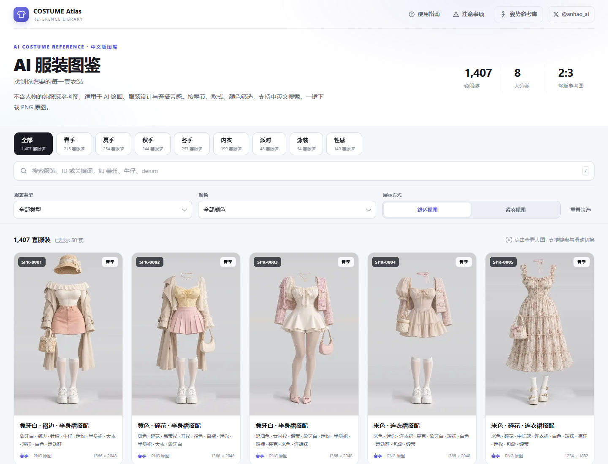
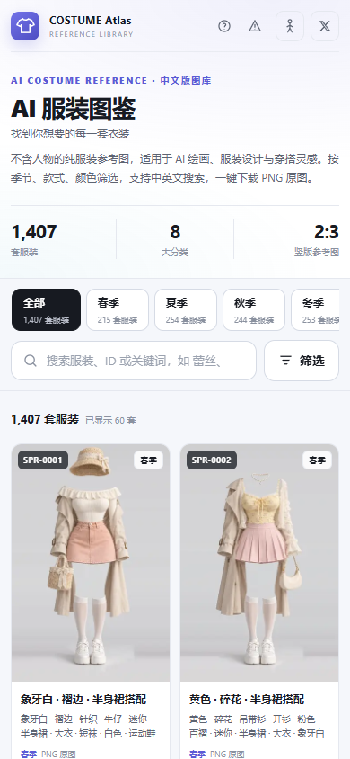
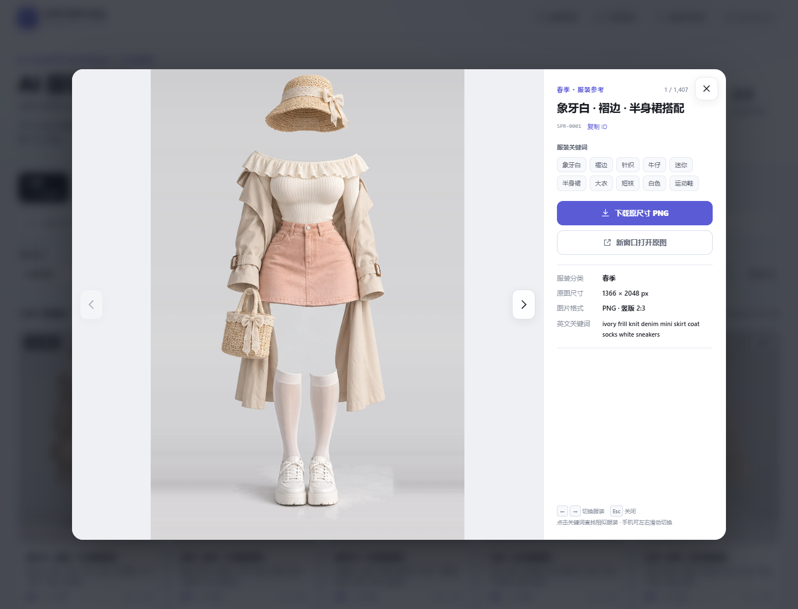

# AI Costume Gallery · 中文版

> 1,407 套 AI 服装参考图、8 大分类，附中英文搜索、组合筛选和可直接部署的响应式静态画廊。



<details>
<summary>手机端预览</summary>



</details>

<details>
<summary>大图浏览预览</summary>



</details>

- **GitHub：** <https://github.com/Stone-dielianhua/ai-costume-gallery-zh>
- **界面与开源说明参考：** [Anhao / AI Pose Gallery 中文版](https://github.com/anhao/ai-pose-gallery-zh)
- **中文数据来源：** <https://ai-costume-gallery-zh.pages.dev/>
- **原始素材站：** <https://ai-costume-gallery.pages.dev/>
- **原作者：** [ギア（@giaaibusi）](https://x.com/giaaibusi)

本仓库为 COSTUME Atlas 的改版源码。上述中文站是数据来源，公开源码不会自动更新该站；新版需另行部署。

## 这是什么

面向 AI 绘画、服装设计和穿搭参考的纯服装图库，以 POSE Atlas 的浅色、紫色点缀界面为参考，提供完整中文索引与响应式浏览体验。无需后端，运行时没有第三方 JavaScript 依赖。

仓库包含页面源码、中文数据索引、全部图片、测试、截图与构建脚本。1,407 套服装的缩略图、WebP 大图与 PNG 原图均已落地，共 4,221 张；页面直接读取仓库内的图片，部署后无需从外部素材站加载。

## 页面功能

- 春季、夏季、秋季、冬季、内衣、派对、泳装、性感 8 个分类，动态显示分类数量。
- 中英文关键词与 ID 搜索，支持同义词、多关键词，以及服装类型、颜色组合筛选。颜色匹配搭配中出现的颜色。
- 舒适 / 紧凑视图、筛选条件标签、一键重置，每批加载 60 套。
- 大图预览、点击关键词搜索相似服装、复制 ID、原尺寸 PNG 下载。
- 键盘左右切换、Esc 关闭，手机支持左右滑动。
- 筛选条件保存在网址中，支持分享以及浏览器前进 / 后退。
- 手机双列网格、图片懒加载、加载失败重试、原生弹窗与焦点恢复。
- 使用指南、原作者使用条款、SEO 元信息、站点地图与社交分享封面。

## 数据规模

| 分类 | 套数 |
| --- | ---: |
| 春季 | 215 |
| 夏季 | 254 |
| 秋季 | 244 |
| 冬季 | 253 |
| 内衣 | 199 |
| 派对 | 48 |
| 泳装 | 54 |
| 性感 | 140 |
| **合计** | **1,407** |

分类统计以 `data/costume-zh.json` 的实际记录为准。

全部图片合计 1,525,033,375 字节（约 1.42 GiB）：

| 目录 | 文件数 | 格式 |
| --- | ---: | --- |
| `thumbs/` | 1,407 | WebP 缩略图 |
| `img/` | 1,407 | WebP 大图 |
| `png/` | 1,407 | PNG 原图 |
| **合计** | **4,221** | |

## 本地预览

需要 Node.js 20 或更新版本。

```sh
git clone https://github.com/Stone-dielianhua/ai-costume-gallery-zh.git
cd ai-costume-gallery-zh
npm ci
npm run dev
```

打开 `http://127.0.0.1:5173`。页面通过 `fetch` 读取 JSON，需要 HTTP 服务，请勿直接双击 HTML。

也可使用任意静态 HTTP 服务托管项目根目录；构建后的 `dist/` 包含全部图片，可独立部署。克隆仓库会一并下载所有图片，未使用 Git LFS。

## 验证与构建

```sh
# 首次测试时安装浏览器；已安装 Windows Chrome 可跳过
npx playwright install chromium
npm test

# 校验全部图片及 SHA-256 清单（需要 Python 3.10+，无第三方依赖）
python scripts/verify.py

# 生成静态部署文件
npm run build
```

16 项桌面与手机测试覆盖分类、组合搜索、分页、空状态、失败重试、弹窗切换、下载文件名、焦点恢复与页面溢出。交互测试使用完整数据与固定图片响应；独立素材测试使用真实本地文件，并阻止外站请求，验证缩略图、大图与 PNG 下载。

`scripts/verify.py` 检查全部 4,221 张图片的存在性、文件头、完整长度标识、尺寸及 SHA-256，依据为 `data/assets-manifest.json`。

测试优先使用 Windows 默认路径的 Chrome，否则使用 Playwright Chromium。可用 `CHROME_PATH` 指定浏览器路径。

构建结果位于 `dist/`，仅包含部署必需的静态文件。`node_modules/`、测试结果与部署压缩包不纳入 Git。

## 部署到 Cloudflare Pages

可将本仓库连接到 Cloudflare Pages，使用以下构建配置：

| 设置 | 值 |
| --- | --- |
| 生产分支 | `main` |
| 框架 | `None` |
| 构建命令 | `npm run build` |
| 输出目录 | `dist` |
| 根目录 | 本项目根目录 |

也可在本地构建后，将 `dist/` 的内容直接上传至 Pages。请将 `dist` 作为发布目录，避免把源码、测试和本地文件作为静态资源发布。

本仓库没有绑定 Cloudflare 账号，也没有保存部署密钥。创建 GitHub 仓库本身不会触发原中文站更新。

### 更换域名

仓库中的正式站点地址目前为 `https://ai-costume-gallery-zh.pages.dev/`。部署到其他域名时，同步替换：

- `index.html` 中的 canonical、hreflang、Open Graph、Twitter Card 与 JSON-LD 地址。
- `robots.txt` 与 `sitemap.xml` 中的地址。

`og-cover.jpg` 是 1200×630 的社交分享封面。`_headers` 提供 Cloudflare Pages 的内容安全策略与缓存配置。

## 目录结构

```text
.
├── index.html              # 中文画廊页面、SEO 与无障碍语义
├── styles.css              # 布局、响应式样式与参考项目设计变量
├── app.js                  # 搜索、筛选、大图浏览与下载
├── data/
│   ├── costume-zh.json     # 1,407 条中文服装记录
│   ├── meta-zh.json        # 分类与搜索同义词
│   └── assets-manifest.json # 图片尺寸、大小与 SHA-256 清单
├── thumbs/                 # 1,407 张 WebP 缩略图
├── img/                    # 1,407 张 WebP 大图
├── png/                    # 1,407 张 PNG 原图
├── docs/                   # 桌面、手机与大图预览截图
├── scripts/
│   ├── serve.mjs           # 本地静态服务
│   ├── build.mjs           # 生成含全部图片的 dist/ 发布目录
│   ├── download.py         # 并发下载、跳过已有文件、失败重试
│   ├── verify.py           # 校验全部图片与 SHA-256
│   └── asset_utils.py      # 图片格式检查与索引读取
├── tests/                  # Playwright 交互测试
├── playwright.config.js
├── package.json
├── package-lock.json
├── _headers
├── .assetsignore
├── robots.txt
├── sitemap.xml
├── og-cover.jpg
├── LICENSE
└── README.md
```

## 数据结构

`data/costume-zh.json` 每条记录对应一套服装：

| 字段 | 示例 | 说明 |
| --- | --- | --- |
| `id` | `SPR-0001` | 唯一标识 |
| `分类` | 春季 | 8 大分类之一 |
| `关键词` | `ivory frill knit …` | 英文关键词 |
| `关键词中文` | 象牙白 · 褶边 · 针织 … | 中文描述 |
| `标签` | `["象牙白", "褶边", "针织"]` | 中文标签数组 |
| `缩略图` | `thumbs/SPR-0001.webp` | 仓库内相对路径 |
| `大图` | `img/SPR-0001.webp` | 仓库内相对路径 |
| `原图` | `png/SPR-0001.png` | 仓库内 PNG 原图相对路径 |
| `宽` / `高` | `1366` / `2048` | 图像尺寸 |
| `检索` | 拼接的中英文关键词 | 检索辅助字段 |

页面中的 `IMAGE_ORIGIN` 自动使用本站地址，图片以相对路径加载，也支持部署到子目录。内容安全策略仅允许本站图片与数据请求。

下载通过请求本站 PNG 并以 Blob 保存；失败时可通过「新窗口打开原图」保存。

## 素材下载与修复

全部图片已包含在 Git 仓库，正常克隆后无需重新下载。若本地文件丢失或损坏，可使用 Python 3.10 或更新版本运行：

```sh
python scripts/download.py
python scripts/download.py --workers 32
python scripts/verify.py
```

下载器默认从原始素材站获取文件，跳过校验通过的本地文件，自动重试失败请求，并以临时文件完成后替换。已有清单时还会检查 SHA-256，避免静默替换素材版本。可通过 `--origin` 指定另一个素材镜像，`--workers` 控制并发数。

## 反馈与贡献

欢迎通过 [Issues](https://github.com/Stone-dielianhua/ai-costume-gallery-zh/issues) 反馈译文、数据或页面问题，也欢迎提交 Pull Request。涉及页面交互的改动请运行 `npm test` 与 `npm run build`。

## 版权与致谢

- 页面设计参考 [Anhao / AI Pose Gallery 中文版](https://github.com/anhao/ai-pose-gallery-zh)，保留其 MIT 版权声明。
- 页面代码、脚本与配置采用 MIT 协议，见 [LICENSE](LICENSE)。该协议不覆盖 `data/` 中的数据以及 `thumbs/`、`img/`、`png/` 中的服装图片。
- 图片与原始数据版权归 [ギア](https://x.com/giaaibusi) 所有，中文索引来自原中文站。本项目不对素材主张权利，也不提供素材的商业使用授权。
- 图片数据本身的再分发、转载及转售受原作者条款约束，使用前请阅读页面注意事项与[原始站点](https://ai-costume-gallery.pages.dev/)说明。
- 若权利人对仓库内容有异议，请通过 Issue 联系处理。
